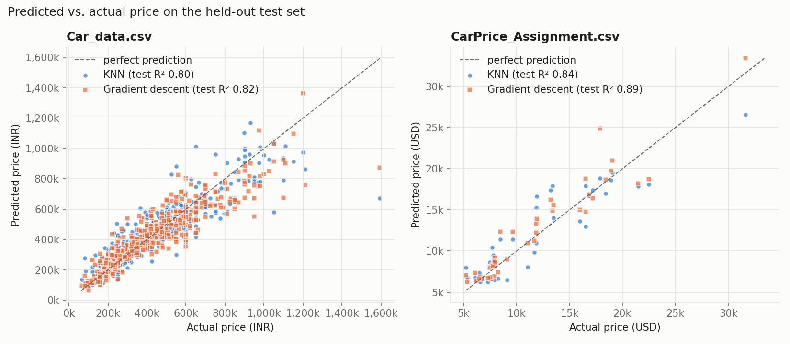
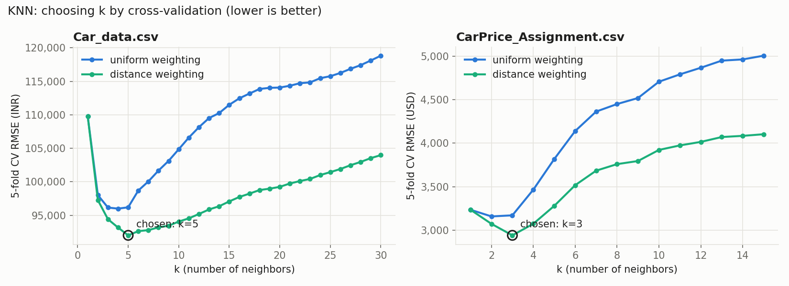
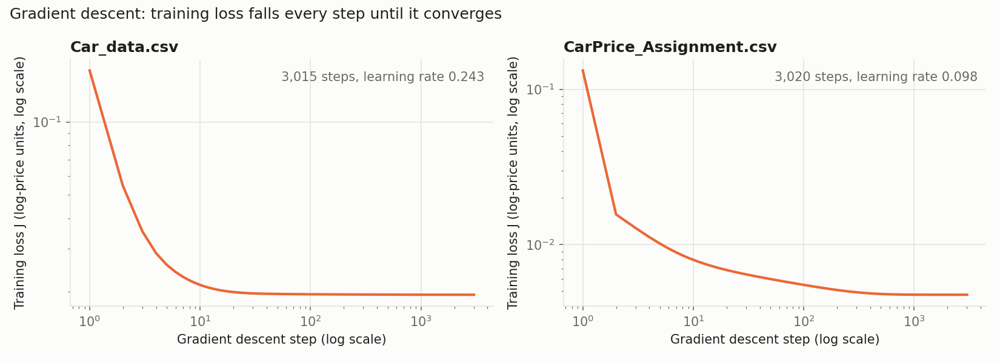

# Car price models: KNN vs. gradient descent

Two regression models, both written from scratch in NumPy, each trained on our two car datasets:

| | `Car_data.csv` | `CarPrice_Assignment.csv` |
|---|---|---|
| What it is | Indian used-car listings | 1985 US auto specs |
| Rows | 2,095 | 205 |
| Target | `selling_price` (INR) | `price` (USD) |
| Features after encoding | 23 | 59 |
| Train / test split | 1,676 / 419 | 164 / 41 |

## Results

All scores below are on the **held-out test set** (20% of rows, never used for training or tuning).

| Dataset | Model | Test R² | RMSE | MAE | MAPE |
|---|---|---|---|---|---|
| Car_data | Baseline (predict the mean) | 0.00 | 238,598 INR | 185,464 INR | 61.7% |
| Car_data | KNN (k = 5, distance-weighted) | 0.805 | 105,364 INR | 68,966 INR | 18.1% |
| Car_data | **Gradient descent** (log price, no L2) | **0.822** | **100,736 INR** | 69,356 INR | **16.9%** |
| CarPrice | Baseline (predict the mean) | −0.10 | 5,987 USD | 5,145 USD | 55.8% |
| CarPrice | KNN (k = 3, distance-weighted) | 0.839 | 2,295 USD | 1,797 USD | 16.3% |
| CarPrice | **Gradient descent** (log price, L2 = 0.01) | **0.889** | **1,910 USD** | **1,357 USD** | **11.8%** |

**Takeaways**

- Both models beat the baseline by a wide margin on both datasets, cutting RMSE by 56–68%.
- **Gradient descent (linear regression) wins on both datasets.** The gap is small on Car_data and clearer on CarPrice. Price is largely a smooth function of a few features (age and power for used cars; weight and engine size for new cars), and a linear model captures that with far fewer parameters than KNN effectively uses.
- **KNN overfits more.** Its training R² is ~1.00 on both datasets (distance weighting means each training car is its own nearest neighbor). Gradient descent's train and test scores are much closer (0.86 vs 0.82, and 0.98 vs 0.89).
- **Predicting log(price) helped a lot.** In cross-validation it lowered gradient descent's RMSE by about 19% on Car_data (108k → 88k INR) and about 10% on CarPrice. Car prices are right-skewed and depreciation is roughly multiplicative, which suits a log model.
- **The test sets are small, especially for CarPrice (41 cars).** A different random split could move these numbers by several points, so treat the KNN vs. gradient descent gap on CarPrice as indicative, not decisive.



Both models struggle with the most expensive cars. On Car_data, the single 1.6M INR car is badly under-predicted by both, and on CarPrice, KNN under-predicts the 31k USD car because few training cars are that expensive. KNN cannot predict a price higher than its most expensive neighbor, while a linear model can extrapolate.

## How each model works

### KNN ([ml/knn.py](../ml/knn.py))

To price a car, find the `k` training cars closest to it in feature space and average their prices. Closeness is Euclidean distance on standardized features, so a 1-std difference in `km_driven` counts as much as a 1-std difference in `engine_cc`.

- **Weighting:** `uniform` (plain mean) or `distance` (each neighbor weighted by 1 / distance).
- **Tuning:** `k` and the weighting are chosen by 5-fold cross-validation on the training split. The search covers k = 1–30 for Car_data and k = 1–15 for CarPrice (only 164 training rows).
- **Result:** distance weighting won on both datasets. Small `k` won: 5 for Car_data and 3 for CarPrice. Error climbs steadily for larger `k` because far-away, dissimilar cars start contributing.



### Gradient descent ([ml/gradient_descent.py](../ml/gradient_descent.py))

This is linear regression, `price ≈ X·w + b`, fitted by full-batch gradient descent on the ridge loss:

```
J(w, b) = 1/(2n) · Σ (X·w + b − y)²  +  (λ/2) · ‖w‖²
∂J/∂w   = Xᵀ(X·w + b − y) / n + λ·w
∂J/∂b   = mean(X·w + b − y)
```

- **Learning rate:** set automatically to `1 / L`, where `L` is the largest eigenvalue of the loss's Hessian. That is the largest step that is guaranteed not to diverge, so the loss falls on every step without hand-tuning. It came out to 0.243 for Car_data and 0.098 for CarPrice.
- **Stopping:** gradient descent stops when the loss improves by less than 1e-9 (relative) in one step. Both runs converged in about 3,000 steps.
- **Tuning by 5-fold CV:** the L2 strength λ ∈ {0, 0.001, 0.01, 0.1, 1} and whether to model log(price).
- **Correctness check:** every run also solves the same problem exactly (closed-form ridge). The test RMSE of the two solutions matches to within 6 INR on Car_data and to the dollar on CarPrice, so gradient descent is reaching the true optimum.



**Largest coefficients** (log-price change per 1 standard deviation of the feature):

| Car_data | | CarPrice | |
|---|---|---|---|
| age | −0.33 | curbweight | +0.19 |
| max_power_bhp | +0.21 | enginesize | +0.10 |
| brand_Maruti | +0.15 | carbody_hatchback | −0.09 |
| brand_Hyundai | +0.09 | carbody_sedan | −0.09 |
| fuel_Diesel | +0.07 | brand_bmw | +0.08 |

Age is the strongest single driver of used-car price, as you'd expect. Brand coefficients are relative to the brand that was dropped during one-hot encoding (Chevrolet for Car_data, Alfa Romeo for CarPrice). So "Maruti +0.15" means Maruti cars sell for more than comparable Chevrolets, not that Maruti is a premium brand. Correlated features (such as engine size and power) share credit, so individual coefficients shouldn't be over-interpreted.

## Data preparation ([ml/data.py](../ml/data.py))

Both models use the same loaders, the same 80/20 split (seed 42) and the same scaling, so the comparison is fair.

**Car_data.csv**
- Dropped the unnamed row-index column.
- `year` → `age` (years before 2020, the newest year in the data).
- `owner` → ordinal 1–4 (first owner … fourth & above); `transmission` → `is_automatic` flag.
- One-hot encoded brand, `fuel`, `seller_type` and `Mileage Unit`.

**CarPrice_Assignment.csv**
- Dropped `car_ID`.
- `CarName` → brand, fixing typos in the source data: `maxda`→mazda, `porcshce`→porsche, `toyouta`→toyota, `vokswagen`/`vw`→volkswagen, `Nissan`→nissan.
- `doornumber` and `cylindernumber` converted from words to numbers.
- One-hot encoded the remaining categorical columns.

**Leakage guard:** the standard scaler is fitted on training rows only. Inside cross-validation it is refitted on each fold's training part.

## Running it

No dependencies beyond NumPy, pandas and matplotlib.

```bash
python3 -m ml.knn                          # KNN, both datasets
python3 -m ml.knn --dataset car_data       # or: carprice
python3 -m ml.gradient_descent             # gradient descent, both datasets
python3 -m ml.report                       # rerun everything and regenerate this report's figures + results.json
python3 -m unittest discover -s ml/tests -t .   # 17 tests
```

The tests check KNN against a brute-force neighbor search, check that gradient descent matches the closed-form solution (with and without L2), check that the loss never increases, and check that the loaders produce complete numeric data with the brand typos fixed.

Each model file exposes its two versions as functions, `run_car_data()` and `run_carprice()`, which return a dict of metrics, chosen hyperparameters and predictions. Full numbers are in [ml_report/results.json](ml_report/results.json).

## Possible next steps

- Repeat the split with several seeds (or nested CV) to get error bars, which matters most for the 205-row CarPrice data.
- Give KNN feature weights or feature selection. Right now every one-hot brand column counts as much as `age`, which probably hurts it.
- Add interaction terms or a log transform of `km_driven` to the linear model.
